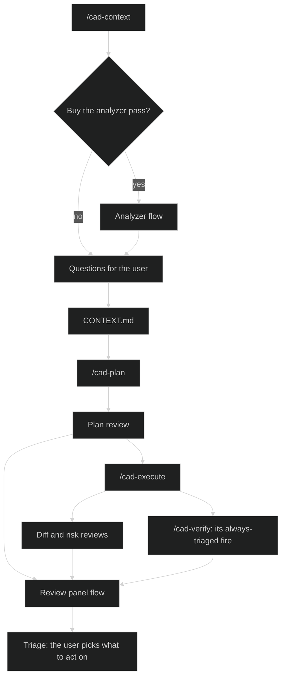
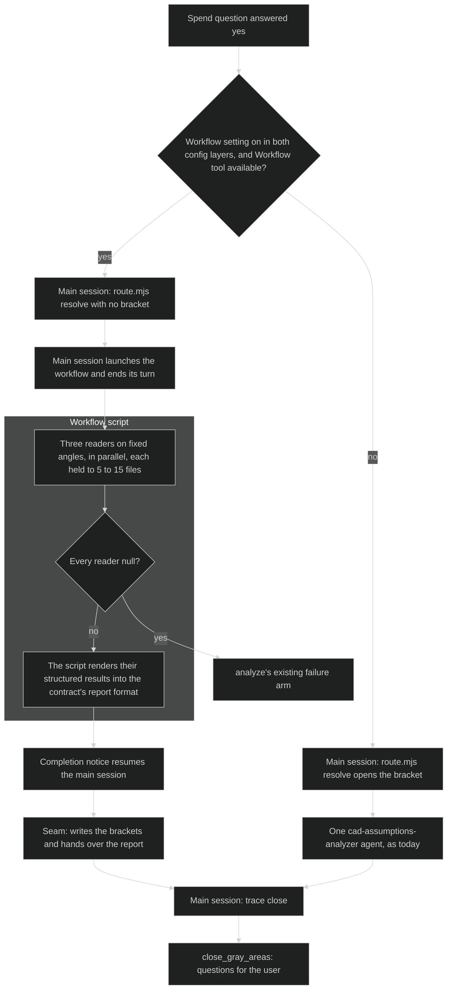

# Review and analyzer flows

Draft for approval.

A workflow script runs agents and nothing else. It can't read files or run `planning.mjs`, so the main session stays responsible for everything that has to land on disk: the run record, the adjudication record and the questions to the user.

Each run takes exactly one path. The workflow path runs only when the workflow setting is on and the `Workflow` tool is available in the session. Otherwise the single-agent path Cadence has today runs. A launch the host refuses takes today's path too. The workflow setting counts only when both config layers set it, the repo's committed config and the user-global config. That is the rule the unattended close already follows, and it means a repo's committed value can't turn on the costlier path for whoever clones it.

A second setting, the multi-workflow setting, is also off by default and takes the same both-layers rule. With it off, a second workflow waits for the first to finish and nothing else is dispatched in between. With it on, overlapping runs keep their scratch files, run record entries and review files apart.

Steps 1 to 3 of `fire(trigger)` stay on the main session. A fire launches the workflow, ends its turn and resumes on the completion notice.

## Where the flows sit

## Analyzer flow

Three readers on fixed angles run in parallel. The script itself renders their structured results into the contract's report format, so there is no combine agent and `close_gray_areas` parses the report as it does today. Each reader is held to the contract's 5 to 15 files. If every reader returns null, the run takes `analyze`'s existing failure arm.

On the workflow path `route.mjs resolve` runs without opening a bracket, because the main session can't know the agents in advance. After the notice a seam writes the brackets and hands over the report. The single agent stays as the old path, with its bracket opened on the resolve.

Evidence for the shape. On the finished by-angle spike run `wf_ddf6d7ce-70f` the readers took 12.9 to 14.9 minutes and the combine agent took 8 minutes with one tool call, against the single analyzer's 17 minutes. That combine step only reformatted, which is why the script does it. The by-subsystem run was stopped at about 32 minutes with its combine step unfinished. Which split finds more was never tested, so the by-angle choice rests on time and on shape, not on findings.

## Review panel flow

The branch is the gate being `adjudicated`, or `/cad-verify`'s always-triaged fire, and then the workflow setting and the `Workflow` tool. `off`, `advisory`, `deferred` and `blocking` keep today's path, `risk_surface` at `blocking` included.

```mermaid
%%{init: {'theme':'dark'}}%%
flowchart TD
  fire["fire(trigger), steps 1 to 3"] --> resolve["Main session: route.mjs resolve gives gate, reviewers, tier and effort"]
  resolve --> gate{"Gate is adjudicated, or the always-triaged fire from /cad-verify?"}
  gate -->|no| today["Today's path for that gate"]
  gate -->|yes| available{"Workflow setting on in both config layers, and Workflow tool available?"}
  available -->|no| today
  available -->|yes| payload["Main session composes each provider payload"]
  payload --> launch{"Launch accepted by the host?"}
  launch -->|no| today
  launch -->|yes| reviewers

  subgraph script["Workflow script"]
    reviewers["One agent per reviewer"] --> local["cad-reviewer agent"]
    reviewers --> wrapped["Agent that only runs the provider review call and returns the envelope"]
    local --> nullrev{"Reviewer returned nothing?"}
    wrapped --> nullrev
    nullrev -->|yes| dropped["Named and dropped"]
    dropped --> emptied{"Set emptied?"}
    emptied -->|yes| fallback["claude-subagent fallback runs"]
    nullrev -->|no| raised["Findings, each kept with the voice that raised it"]
    emptied -->|no| raised
    fallback --> raised
    raised --> checkers["One checker per finding per raising voice, ahead of any merge, on the resolved cad-reviewer rung with tools limited"]
    checkers --> nullchk{"Checker returned nothing?"}
    nullchk -->|yes| tomain["That finding goes to the main session"]
    nullchk -->|no| ruling{"Ruling"}
    ruling -->|refuted| killed["Refuted"]
    ruling -->|proved| survived["Survived, with all six headings"]
    ruling -->|neither| suspected["Suspected, with the next check named"]
  end

  killed --> notice["Completion notice resumes the main session"]
  survived --> notice
  suspected --> notice
  tomain --> notice
  notice --> figures["Seam: reads the run file and writes one bracket per agent, or one bracket with the notice's totals"]
  figures --> build["Seam: builds the adjudication payload and the review input from the result on disk"]
  build --> today2
  today --> today2["Record and triage steps, which apply on both paths"]
  today2 --> merge["Main session merges and groups root causes after the rulings"]
  merge --> file["The review file gets six headings per survivor"]
  file --> show["Triage prints what breaks, why it matters, what is uncertain and a recommendation, and answers what triggers it and what proves it from the review file on request"]
  show --> kind{"Survivor"}
  kind -->|neither, a suspected blocker or high| offer["Offer: run the check, fix it, or override with a reason"]
  kind -->|proved blocker or high the answer left unnamed| offer2["Offer: fix it, or override with a reason"]
  kind -->|neither, lower severity| recorded["Shown as suspected with its next check, recorded survived"]
  offer --> rerule["A survivor the named check re-rules is marked in the review file"]
  offer2 --> write
  rerule --> write["A fire holding a blocker or high writes its record after those answers"]
  recorded --> write2["The record is written"]
```

Both paths end in the same record and triage steps, so the findings format reads the same with the workflow setting on or off. On the old path the main session fills in the headings when it checks.

Triage answers stay advisory. The recommendation preselects nothing, NONE stays first and default, and no new answer is added. A suspected finding is never downgraded and counts as a hit for the reviewer that raised it.

## Cost

One agent per finding costs far more tokens than the main session opening the file, per `.planning/spikes/per-finding-agent-cost/SPIKE.md`. It was chosen on technical grounds: independence from the session running the work, isolation between findings, schema-enforced output and a smaller main session.
