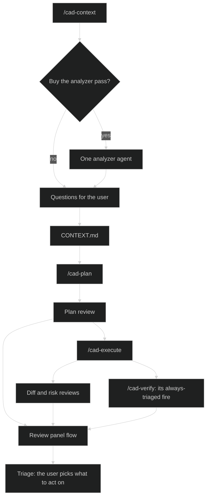

# Review flows

A workflow script runs agents and nothing else. It can't read files or run `planning.mjs`, so the main session stays responsible for everything that has to land on disk: the run record, the adjudication record and the questions to the user.

Each run takes exactly one path. The workflow path runs only when the workflow setting is on and the `Workflow` tool is available in the session. Otherwise the single-agent path Cadence has today runs. A launch the host refuses takes today's path too. The workflow setting counts only when both config layers set it, the repo's committed config and the user-global config. That is the rule the unattended close already follows, and it means a repo's committed value can't turn on the costlier path for whoever clones it.

A second setting, the multi-workflow setting, is also off by default and takes the same both-layers rule. With it off, a second workflow waits for the first to finish and nothing else is dispatched in between. With it on, overlapping runs keep their scratch files, run record entries and review files apart.

Steps 1 to 3 of `fire(trigger)` stay on the main session. A fire launches the workflow, ends its turn and resumes on the completion notice.

## Where the flows sit

## The analyzer is one agent

The analyzer is not a workflow. `/cad-context` runs one `cad-assumptions-analyzer` agent on every path, whatever `workflow.use_workflows` says, and that setting now gates only the review panel.

Phase 2 measured three ways to run it. One agent took 12.4 minutes and 1.33M tokens summed across every turn. Three readers on angles took 9.5 minutes and 2.87M. Three readers on slices took 9.7 minutes and 2.19M. A blind judge preferred the single agent's report over the angles report. The judge for the slices report was stopped before it finished. The workflows saved under three minutes and cost 1.6 to 2.2 times the tokens, with no better report.

John's call: "i'm thinking the one agent for analyzer".

## Review panel flow

The branch is the gate being `adjudicated`, or `/cad-verify`'s always-triaged fire, and then the workflow setting and the `Workflow` tool. `off`, `advisory`, `deferred` and `blocking` keep today's path, `risk_surface` at `blocking` included. They end on their own path and never reach the record and triage steps below.

```mermaid
%%{init: {'theme':'dark'}}%%
flowchart TD
  fire["fire(trigger), steps 1 to 3"] --> resolve["Main session: route.mjs resolve gives gate, reviewers, tier and effort"]
  resolve --> gate{"Gate is adjudicated, or the always-triaged fire from /cad-verify?"}
  gate -->|no| gatepath["Today's path for that gate, with no triage step after it"]
  gate -->|yes| available{"Workflow setting on in both config layers, and Workflow tool available?"}
  available -->|no| oldpath
  available -->|yes| payload["Main session composes each provider payload"]
  payload --> launch{"Launch accepted by the host?"}
  launch -->|no| oldpath["Today's adjudicated path: the main session checks the findings and fills in the headings"]
  launch -->|yes| reviewers

  subgraph script["Workflow script"]
    reviewers["One agent per reviewer"] --> local["cad-reviewer agent"]
    reviewers --> wrapped["Agent that only runs the provider review call and returns the envelope"]
    local --> nullrev{"Reviewer returned nothing?"}
    wrapped --> nullrev
    nullrev -->|yes| dropped["Named and dropped"]
    dropped --> emptied{"Set emptied?"}
    emptied -->|yes| fallback["claude-subagent fallback runs"]
    nullrev -->|no| raised["Findings, each kept with the voice that raised it"]
    emptied -->|no| raised
    fallback --> raised
    raised --> checkers["One checker per finding per raising voice, ahead of any merge, on the resolved cad-reviewer rung with tools limited"]
    checkers --> nullchk{"Checker returned nothing?"}
    nullchk -->|yes| tomain["That finding goes to the main session"]
    nullchk -->|no| ruling{"Ruling"}
    ruling -->|refuted| killed["Refuted"]
    ruling -->|proved| survived["Survived, with all six headings"]
    ruling -->|neither| suspected["Suspected, with the next check named"]
  end

  killed --> notice["Completion notice resumes the main session"]
  survived --> notice
  suspected --> notice
  tomain --> notice
  notice --> figures["Seam: reads the run file and writes one bracket per agent, or one bracket with the notice's totals"]
  figures --> build["Seam: builds the adjudication payload and the review input from the result on disk"]
  build --> today2["Record and triage steps, which apply on both paths"]
  oldpath --> today2
  today2 --> merge["Main session merges and groups root causes after the rulings"]
  merge --> file["The review file gets six headings per survivor"]
  file --> show["Triage prints what breaks, why it matters, what is uncertain and a recommendation, and answers what triggers it and what proves it from the review file on request"]
  show --> kind{"Survivor after the triage answer"}
  kind -->|suspected blocker or high, named or not| offer["Offer: run the check, fix it, or override with a reason"]
  kind -->|proved blocker or high the answer named| named["Fix it: naming it is the answer"]
  kind -->|proved blocker or high the answer left unnamed| offer2["Offer: fix it, or override with a reason"]
  kind -->|lower severity the answer named| acted["Acted on, as the answer says"]
  kind -->|proved lower severity the answer left unnamed| unnamed["Settled as a finding this fire will not fix, recorded not fixed"]
  kind -->|suspected lower severity the answer left unnamed| recorded["Shown as suspected with its next check, recorded survived"]
  offer -->|run the check| rerule{"Check result"}
  offer -->|fix it or override| write["The record is written, once every blocker or high survivor is settled"]
  rerule -->|refuted| refuted["Recorded refuted with the counter-evidence, and the survivor marked in the review file"]
  rerule -->|proved| marked["Survivor marked re-ruled in the review file"]
  rerule -->|settles nothing| offer2
  marked --> offer2
  refuted --> write
  named -->|fix made| write
  named -->|fix not made| offer2
  offer2 --> write
  acted --> write
  unnamed --> write
  recorded --> write
```

Both paths end in the same record and triage steps, so the findings format reads the same with the workflow setting on or off. On the old path the main session fills in the headings when it checks.

Triage answers stay advisory. The recommendation preselects nothing, NONE stays first and default, and no new answer is added. A suspected finding is never downgraded and counts as a hit for the reviewer that raised it.

## Cost

One agent per finding costs far more tokens than the main session opening the file, per `.planning/spikes/per-finding-agent-cost/SPIKE.md`. It was chosen on technical grounds: independence from the session running the work, isolation between findings, schema-enforced output and a smaller main session.
